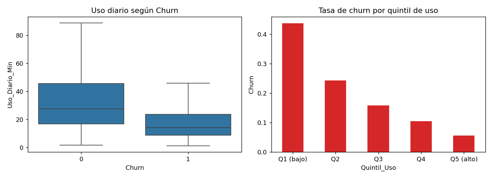
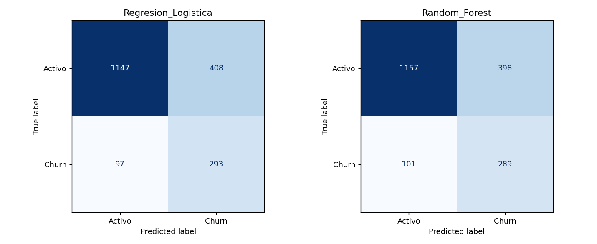
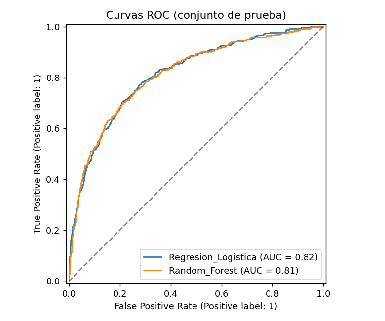
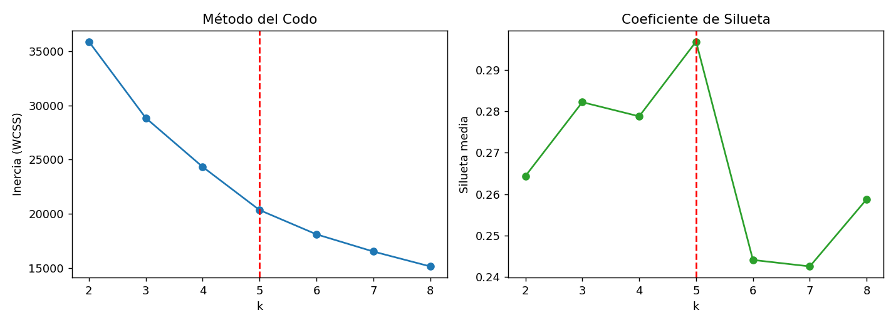
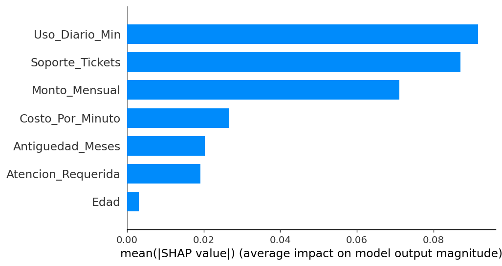
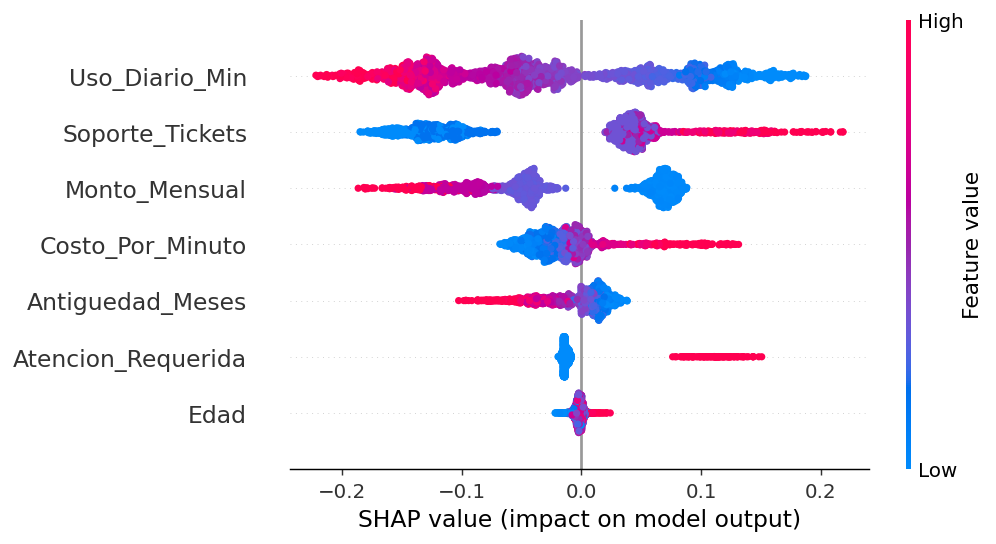
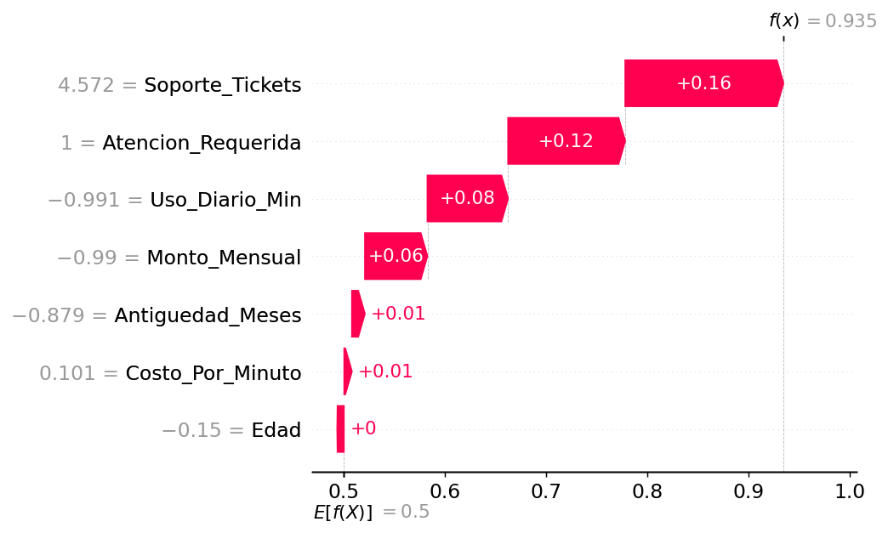
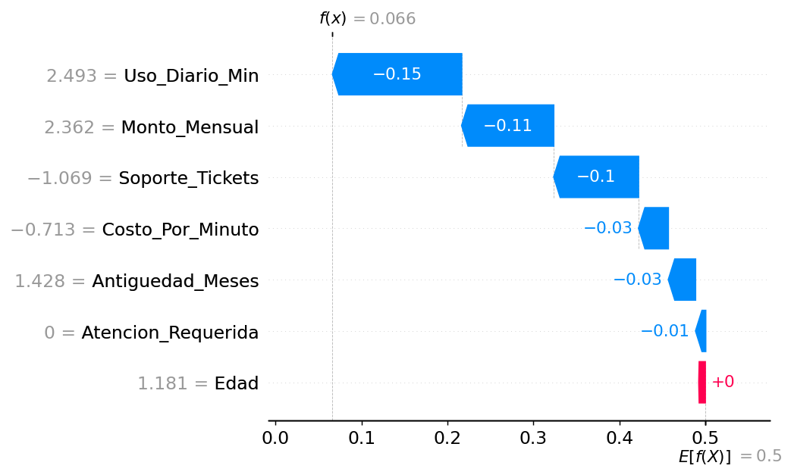
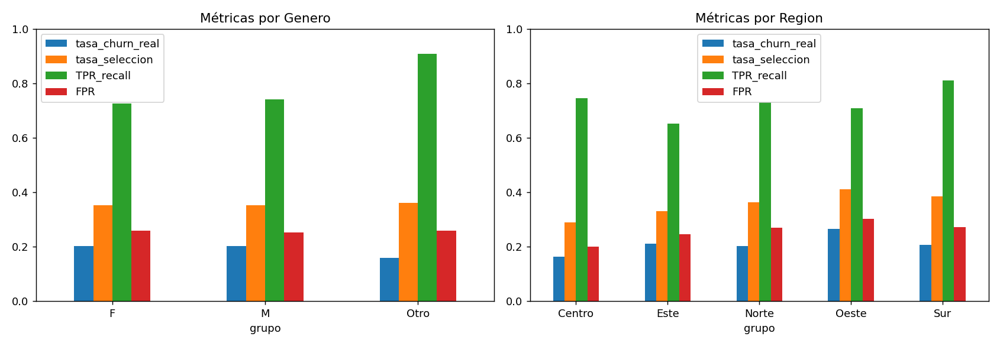

# Informe Técnico: Sistema Predictivo y Prescriptivo de Abandono de Clientes
**DataCloud Solutions — TCC Ciencia de Datos II**

> **Nota sobre los resultados.** Las cifras de este informe provienen de un dataset **sintético** generado con `src/generate_data.py` (10,000 registros con los problemas de calidad del enunciado). Si usas el CSV oficial, vuelve a ejecutar los scripts y **actualiza las cifras y las figuras** (las secciones y la metodología no cambian). Todos los análisis (EDA, modelado, clustering, equidad y SHAP) fueron ejecutados; la suite `tests/test_pipeline.py` verifica que las cifras de este informe coincidan con los resultados guardados en `data/processed/`.

---

## 1. Fase 1 — Fundamentos de Ciencia de Datos

### 1.1 Formulación CRISP-DM

| Etapa | Aplicación al caso |
|---|---|
| **Comprensión del negocio** | Reducir la fuga de clientes B2B. Objetivo: anticipar quién cancelará en 30 días y entender perfiles de uso para diseñar retención personalizada. Un cliente retenido vale más que el costo de una campaña, por lo que **perder un churner (falso negativo) es más caro que contactar a un cliente que no se iba (falso positivo)**. |
| **Comprensión de datos** | 10,000 registros, 9 variables, con duplicados, nulos, outliers, formatos mixtos y desbalance (~20% churn). |
| **Preparación** | Limpieza, imputación, *feature engineering*, codificación y escalado (Fase 2). |
| **Modelado** | Supervisado (churn) y no supervisado (segmentación). |
| **Evaluación** | Métricas sensibles al desbalance, explicabilidad (SHAP) y equidad. |
| **Despliegue** | App Streamlit + repositorio reproducible. |

### 1.2 Métrica principal: por qué no Accuracy

Con 80% de clientes activos, un modelo trivial que predice siempre "activo" obtiene **Accuracy ≈ 0.80 con Recall = 0** (verificado en `train.py`: 0.799). Por eso se usa:

$$\text{Precision}=\frac{TP}{TP+FP},\qquad \text{Recall}=\frac{TP}{TP+FN},\qquad F_1=\frac{2\cdot P\cdot R}{P+R}$$

**Métrica técnica principal: Recall de la clase Churn, controlada por F1** (para no inflar el Recall prediciendo churn a todos). Se complementa con ROC-AUC y PR-AUC, que son independientes del umbral. El criterio de selección de hiperparámetros y de modelo es **F1 en validación cruzada**; el umbral puede bajarse en producción si el costo de retención es bajo.

### 1.3 EDA

- **Calidad (crudo):** 78 IDs nulos, 200 duplicados (478 filas con ID repetido), 1,588 NAs en `Soporte_Tickets`, ~115 edades imposibles, 293 montos en centavos.
- **Sesgo:** asimetría de `Uso_Diario_Min` = 4.07, `Costo_Por_Minuto` = 5.07, `Monto_Mensual` = 2.31 → justifica la transformación logarítmica. Ver `eda_distribuciones.png`.
- **Correlaciones (Spearman con Churn):** `Uso_Diario_Min` −0.33, `Monto_Mensual` −0.27, `Soporte_Tickets` +0.25, `Costo_Por_Minuto` +0.18, `Antiguedad_Meses` −0.07 y `Edad` +0.01 (`eda_correlacion.png`). Que `Monto_Mensual` se asocie *negativamente* con el churn es coherente con el diseño de los planes: las tarifas altas corresponden a clientes de uso intensivo.

**Hipótesis: ¿a mayor uso diario, menor probabilidad de abandono?**

| Quintil de uso | Q1 (bajo) | Q2 | Q3 | Q4 | Q5 (alto) |
|---|---|---|---|---|---|
| Tasa de churn | 43.8% | 24.3% | 15.8% | 10.4% | 5.6% |

Mediana de uso: 27.6 min (activos) vs. 14.0 min (cancelaron). Spearman ρ = −0.332 (p ≈ 10⁻²⁴⁹) y Mann–Whitney unilateral p ≈ 10⁻²³⁶. **La hipótesis se confirma** con relación monótona decreciente. *Advertencia:* es asociación, no causalidad (un cliente que ya decidió irse puede reducir su uso antes de cancelar).

{width=58%}

*Figura 1. Uso diario según churn y tasa de churn por quintil de uso.*

---

## 2. Fase 2 — Calidad de datos e ingeniería de características

### 2.1 Limpieza

| Problema | Tratamiento | Justificación |
|---|---|---|
| ID nulo / duplicado | Eliminar nulos y conservar la primera aparición | Sin ID no hay trazabilidad; los duplicados sesgan métricas y pueden filtrar filas entre train y test. Quedan 9,722 filas. |
| `Antiguedad_Meses` mixta | Regex que extrae el número; "años" × 12; fuera de [0, 600] → NaN | Unifica a meses numéricos. |
| `Edad` outliers | Fuera de [18, 90] → NaN → mediana | Reglas de dominio; la mediana es robusta. |
| `Monto_Mensual` escalas | > 1000 se interpreta como centavos (÷100) | Los planes reales no superan ~US$ 500. |
| `Soporte_Tickets` NAs | **Imputación por mediana + indicador `Soporte_Faltante`** | Ver abajo. |

**Imputación de `Soporte_Tickets`.** La variable es un conteo asimétrico, por lo que la media se distorsiona con valores altos; la **mediana** es robusta. Como los NAs **no son aleatorios** (en los datos faltan más cuando hay más tickets, MNAR), cualquier imputación introduce sesgo: se añade el indicador `Soporte_Faltante` para que el modelo pueda aprender si la ausencia es informativa. Se descartó KNN Imputer porque para una sola variable de conteo con MNAR no aporta mejora clara y encarece el pipeline. Para evitar fuga de datos, **la imputación se ajusta dentro del `Pipeline`, solo con datos de entrenamiento de cada fold**.

### 2.2 Ingeniería de características

$$\text{Costo\_Por\_Minuto}=\frac{\text{Monto\_Mensual}}{\text{Uso\_Diario\_Min}\times 30},\qquad
\text{Atencion\_Requerida}=\mathbb{1}[\text{Soporte\_Tickets}>5]$$

El uso se acota a ≥ 1 min en el denominador para evitar divisiones por cero. Transformaciones: `log1p` en las variables sesgadas (comprime la cola derecha), `StandardScaler` $z=(x-\mu)/\sigma$ en continuas y One-Hot en `Genero` y `Region` (`handle_unknown="ignore"`).

### 2.3 Selección de características
`SelectFromModel` con un Random Forest (umbral = 0.5 × importancia media) **dentro del Pipeline**. De 16 variables transformadas se conservan **7**: `Uso_Diario_Min`, `Monto_Mensual`, `Costo_Por_Minuto`, `Edad`, `Antiguedad_Meses`, `Soporte_Tickets`, `Atencion_Requerida`. Se descartan `Genero`, `Region` y `Soporte_Faltante`.

---

## 3. Fase 3 — Modelado supervisado

- **Partición:** hold-out estratificado 80/20 (7,777 / 1,945; churn 20.0% / 20.1%) y `StratifiedKFold(5)` dentro de `GridSearchCV`, para preservar la proporción de clases en cada fold.
- **Desbalance:** `class_weight='balanced'` (penaliza más el error en la clase minoritaria: peso $w_c = n/(2\,n_c)$). Alternativa implementada: `--smote` (SMOTE dentro del pipeline de `imblearn`, aplicado solo a los folds de entrenamiento).
- **Modelos:** Regresión Logística (base) y Random Forest. *(XGBoost queda como extensión opcional.)*
- **Búsqueda:** `GridSearchCV` con `refit="f1"`. LogReg: C ∈ {0.01, 0.1, 1, 10}. RF: `n_estimators` ∈ {200, 300}, `max_depth` ∈ {4, 6, 10}, `min_samples_leaf` ∈ {5, 20}.

### Resultados (conjunto de prueba)

| Modelo | Accuracy | Precision | **Recall** | **F1** | ROC-AUC | PR-AUC | F1 CV |
|---|---|---|---|---|---|---|---|
| Regresión Logística (C=0.1) | 0.740 | 0.418 | 0.751 | 0.537 | 0.816 | 0.581 | 0.509 |
| Random Forest (prof. 6, hoja 20, 200 árb.) | 0.743 | 0.421 | 0.741 | 0.537 | 0.814 | 0.568 | 0.509 |

Figuras: `matrices_confusion.png`, `curvas_roc.png`.

{width=54%} {width=32%}

*Figura 2. Matrices de confusión (izquierda) y curvas ROC (derecha) en el conjunto de prueba.*

**Interpretación.** Ambos modelos recuperan ~74–75% de los clientes que cancelan, con una precisión de ~42% (de cada 10 alertas, ~4 son churn real, el doble de la tasa base de 20%). Los modelos son prácticamente equivalentes; el Random Forest se selecciona por F1 en CV (empate técnico) y porque `TreeExplainer` de SHAP es exacto y rápido para árboles. La Regresión Logística es una alternativa igual de válida y más simple de auditar. La Accuracy (0.74) es *menor* que la del modelo trivial (0.80), lo cual es esperado y deseable: el modelo sacrifica Accuracy para detectar churners.

> El resultado de test **no** se usó para elegir el modelo (se eligió por CV), evitando optimismo por selección.

**Advertencia: el puntaje no es una probabilidad calibrada.** Con `class_weight='balanced'` el modelo sobrestima el riesgo a propósito para favorecer el Recall: en el conjunto de prueba la probabilidad media predicha es 0.41 frente a una tasa real de churn de 0.20, y los clientes con puntaje entre 0.5 y 0.6 cancelan en realidad el 22% de las veces. El puntaje sirve para **ordenar** clientes por riesgo y decidir a quién contactar, pero no debe leerse literalmente ("93.5% de probabilidad"). Si se necesita una probabilidad interpretable, debe aplicarse `CalibratedClassifierCV` (Platt o isotónica) sobre el modelo final.

---

## 4. Fase 4 — Segmentación (K-Means)

Se agrupa con variables de **comportamiento** (`Uso_Diario_Min`, `Monto_Mensual`, `Costo_Por_Minuto`, `Antiguedad_Meses`, `Soporte_Tickets`; sin Churn ni demografía), con `log1p` + estandarización. K-Means minimiza

$$J=\sum_{j=1}^{k}\sum_{x_i\in C_j}\lVert x_i-\mu_j\rVert^2 ,\qquad s(i)=\frac{b(i)-a(i)}{\max\{a(i),b(i)\}}$$

donde $a(i)$ es la distancia media intra-cluster y $b(i)$ la distancia media al cluster vecino más cercano.

| k | 2 | 3 | 4 | **5** | 6 | 7 | 8 |
|---|---|---|---|---|---|---|---|
| Silueta | 0.264 | 0.282 | 0.279 | **0.297** | 0.244 | 0.243 | 0.259 |

El codo es suave (sin quiebre marcado); la silueta es máxima en **k = 5** (se exige k ≥ 3 para que la segmentación sea accionable). Una silueta ≈ 0.3 indica estructura **moderada**: los grupos se solapan, como es normal en datos de comportamiento continuo. Figura: `clustering_codo_silueta.png`.

{width=56%}

*Figura 3. Método del codo y coeficiente de silueta (k óptimo = 5).*

| Cluster | Tamaño | Uso (min) | Monto (US$) | Tickets | Antigüedad (m) | **Churn** | Perfil sugerido |
|---|---|---|---|---|---|---|---|
| 0 | 8.4% | 5.9 | 49 | 2.0 | 21 | **53%** | Usuarios casi inactivos, plan básico (riesgo crítico) |
| 1 | 15.6% | 24.7 | 87 | 1.6 | 46 | 13% | Clientes antiguos y estables |
| 2 | 10.8% | 29.1 | 104 | **6.0** | 20 | **41%** | Clientes con alto soporte (insatisfechos) |
| 3 | 43.3% | 21.6 | 74 | 1.3 | 15 | 19% | Base general reciente (churn ≈ promedio) |
| 4 | 22.0% | 76.1 | 292 | 1.6 | 20 | **5%** | Usuarios intensivos de tarifa alta (los más leales) |

**Estrategias prescriptivas:** C0 → *onboarding* y campañas de activación; C2 → atención prioritaria (gerente de cuenta, resolución de incidencias); C3 → seguimiento en los primeros meses; C1 → fidelización; C4 → *upselling* y programas de referidos.

---

## 5. Fase 5 — Explicabilidad, ética y producto

### 5.1 Explicabilidad (SHAP)
SHAP asigna a cada variable $j$ su valor de Shapley, la contribución marginal promedio sobre todos los subconjuntos de variables:

$$\phi_j=\sum_{S\subseteq F\setminus\{j\}}\frac{|S|!\,(|F|-|S|-1)!}{|F|!}\,[f(S\cup\{j\})-f(S)],\qquad f(x)=\phi_0+\sum_j\phi_j$$

`src/explain.py` calcula con `TreeExplainer`: (i) la importancia global (media de |SHAP|), determinando el **top 3**, (ii) la distribución direccional del impacto (*beeswarm*), y (iii) los gráficos de cascada (*waterfall*) de 2 clientes individuales del conjunto de prueba.

#### Importancia Global (Media de |SHAP|)

| Variable | Media \|SHAP\| | Interpretación del efecto |
|---|---|---|
| **`Uso_Diario_Min`** | **0.0917** | **Variable #1:** el bajo uso diario es el principal disparador de la probabilidad de cancelación. |
| **`Soporte_Tickets`** | **0.0870** | **Variable #2:** la acumulación de incidencias y quejas técnicas aumenta marcadamente el riesgo. |
| **`Monto_Mensual`** | **0.0710** | **Variable #3:** efecto *protector*: las tarifas altas (planes de uso intensivo) reducen el riesgo y las tarifas bajas lo aumentan (ver beeswarm). Actúa como proxy del plan contratado. |
| `Costo_Por_Minuto` | 0.0267 | Razón de valor percibido: pagar mucho por cada minuto realmente usado incrementa el churn. |
| `Antiguedad_Meses` | 0.0203 | Clientes nuevos tienen mayor propensión a cancelar que cuentas maduras. |
| `Atencion_Requerida`| 0.0192 | Umbral crítico (> 5 tickets): el churn pasa de 18% a 51.5% al superarlo. Comparte información con `Soporte_Tickets`, por lo que el efecto total del soporte es mayor que el de cada variable por separado. |
| `Edad` | 0.0031 | Prácticamente sin influencia sobre la decisión de abandono. |

**TOP 3 variables más determinantes:** `['Uso_Diario_Min', 'Soporte_Tickets', 'Monto_Mensual']`.  
*Contraste metodológico:* la importancia por impureza (Gini) del Random Forest coloca a `Monto_Mensual` (0.23) ligeramente por encima de `Soporte_Tickets` (0.22), mientras que SHAP invierte ese orden (0.071 vs. 0.087). Ambas métricas miden cosas distintas: la impureza mide cuánto reduce cada variable el desorden en las divisiones de los árboles y tiende a favorecer variables continuas con muchos valores distintos (como el monto), mientras que SHAP mide cuánto desplaza cada variable la predicción final. Para explicar predicciones es preferible SHAP. Los valores de SHAP están en la escala del puntaje del modelo (probabilidad de la clase churn, entre 0 y 1) y su valor base es E[f(X)] = 0.5, no la tasa real de 20%, por el mismo efecto de `class_weight='balanced'` descrito en la sección 3.

Figuras generadas: `reports/figures/shap_global_barras.png` (magnitud media absoluta) y `reports/figures/shap_global_beeswarm.png` (direccionalidad: valores bajos de uso, valores altos de tickets, tarifas bajas y baja antigüedad empujan hacia churn; un `Costo_Por_Minuto` alto también).

{width=44%} {width=46%}

*Figura 4. SHAP global: magnitud media (izquierda) y dirección del efecto (derecha).*

#### Explicación Individual de Casos en Test (*Waterfall Plots*)

1. **Cliente de alto riesgo (índice 1154, P(churn) = 93.5% | canceló en la realidad: 1):**
   - Perfil: `Uso_Diario_Min` = 11.1 min, `Soporte_Tickets` = 11, `Atencion_Requerida` = 1, `Monto_Mensual` = US$ 48.27, `Antiguedad_Meses` = 9 meses.
   - Principales contribuciones SHAP positivas (empujan hacia cancelación): `Soporte_Tickets` (+0.157), `Atencion_Requerida` (+0.116), `Uso_Diario_Min` (+0.080) y `Monto_Mensual` (+0.062).
   - Figura: `reports/figures/shap_individual_alto_riesgo.png`.

2. **Cliente de bajo riesgo (índice 1269, P(churn) = 6.6% | activo en la realidad: 0):**
   - Perfil: `Uso_Diario_Min` = 167.9 min, `Soporte_Tickets` = 0, `Atencion_Requerida` = 0, `Monto_Mensual` = US$ 474.17, `Antiguedad_Meses` = 43 meses.
   - Principales contribuciones SHAP negativas (empujan fuertemente hacia la permanencia): `Uso_Diario_Min` (-0.150), `Monto_Mensual` (-0.107), `Soporte_Tickets` (-0.099), `Costo_Por_Minuto` (-0.035) y `Antiguedad_Meses` (-0.032).
   - Figura: `reports/figures/shap_individual_bajo_riesgo.png`.

{width=40%} {width=40%}

*Figura 5. Explicación individual SHAP: cliente de alto riesgo (izquierda) y de bajo riesgo (derecha).*

### 5.2 Evaluación de equidad (Fairness)

Métricas por grupo sobre el conjunto de prueba (`src/fairness.py`):

| Atributo | Dif. paridad demográfica | Ratio impacto dispar | Dif. TPR | Dif. FPR |
|---|---|---|---|---|
| Género | 0.010 | 0.973 (cumple) | 0.182 | 0.006 |
| Región | 0.121 | 0.705 (no cumple, < 0.8) | 0.157 | 0.103 |

{width=58%}

*Figura 6. Tasa de churn real, tasa de selección, TPR y FPR por grupo de Género y Región.*

- **Género:** las tasas de selección son casi idénticas (35.2–36.2%). La diferencia de TPR se debe al grupo "Otro" (n = 69, ~11 churners reales): **muestra demasiado pequeña** para concluir.
- **Región:** el ratio de impacto dispar (0.705) incumple la regla del 80%. Parte de la diferencia refleja tasas de churn reales distintas (Oeste 26.7% vs. Centro 16.4%), y los grupos pequeños (Oeste, n = 90) generan métricas ruidosas. El modelo **no usa** `Genero` ni `Region` como entradas (las descarta la selección), así que la disparidad proviene de **variables proxy** (uso, tarifa, soporte) correlacionadas con la región. Es un hallazgo a vigilar, no una prueba de discriminación.

### 5.3 Protocolo de mitigación de sesgos y privacidad

1. **Minimización:** no usar `Genero` ni `Region` como entradas del modelo (ya se descartan); conservarlos solo para auditoría.
2. **Auditoría periódica:** ejecutar `fairness.py` en cada reentrenamiento, con alerta si el ratio de impacto dispar < 0.8 o la diferencia de TPR > 0.10 en grupos con n ≥ 30.
3. **Mitigación técnica:** si persiste la brecha, aplicar reponderación por grupo, umbrales por grupo o *post-processing* de odds igualadas (`fairlearn`), evaluando el costo en F1.
4. **Uso humano:** el modelo **recomienda acciones de retención, no decisiones punitivas** (nunca negar servicio ni subir precios según el score). Revisión humana de casos de alto impacto.
5. **Privacidad (Ley 1581 de 2012 en Colombia / GDPR):** finalidad explícita, base legal y consentimiento; minimización y seudonimización de `ID_Cliente`; control de acceso, cifrado y retención limitada; derecho de acceso, rectificación y supresión; documentación del modelo (*model card*) y registro de versiones.
6. **Monitoreo de deriva:** vigilar la distribución de entradas y la calidad del modelo en producción y reentrenar cuando se degrade.

### 5.4 Producto final
La app (`app/app.py`, Streamlit) permite ingresar los datos de un cliente y muestra: (1) el **puntaje de riesgo de churn** (no calibrado, ver sección 3) y la decisión según un umbral ajustable, (2) el cluster y el perfil, (3) acciones de retención sugeridas y (4) el gráfico SHAP *waterfall* de esa predicción. Ejecución local: `streamlit run app/app.py` (http://localhost:8501). Despliegue en la nube: repositorio en GitHub con `models/best_model.joblib`, `models/cluster_model.joblib` y `data/processed/test_set.csv`, conectado a Streamlit Community Cloud con `app/app.py` como archivo principal. Como los modelos se guardan con `joblib`, deben entrenarse y servirse con la misma versión de scikit-learn (fijada en `requirements.txt`).

---

## 6. Limitaciones y trabajo futuro

- Resultados sobre datos sintéticos; validar con el dataset real.
- El umbral 0.5 no es necesariamente el óptimo de negocio: calibrarlo con costos reales (costo de retención vs. valor de vida del cliente) y calibrar las probabilidades (ver advertencia en la sección 3).
- Probar XGBoost y SMOTE (`--smote`) y comparar con intervalos de confianza (bootstrap).
- Validar la estabilidad de los clusters (re-muestreo) y probar DBSCAN/GMM.
- El enunciado pide predecir churn a 30 días, pero el dataset es una foto histórica: confirmar que las variables se midieron *antes* de la cancelación para evitar fuga temporal.
